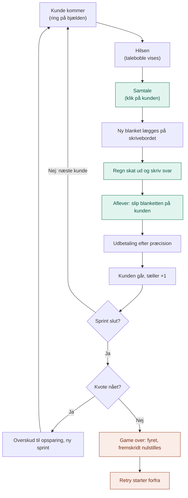
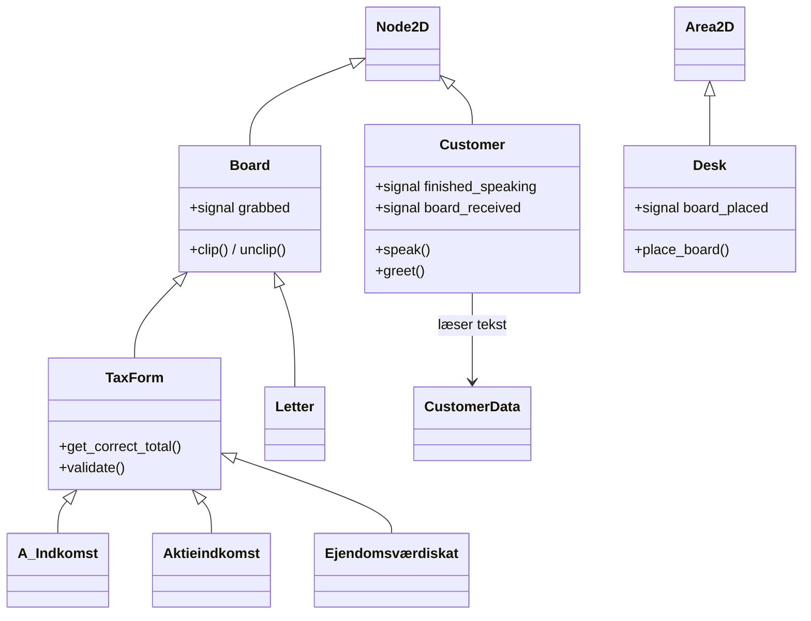

# dd-uge-2

Undulaternes DDU projekt 2: et 2D-spil lavet i Godot 4 om at hjælpe folk med deres skat.

## Om spillet

Spillet ligner strukturelt *Papers, Please*. Du sidder bag et skrivebord som skattemedarbejder, og kunder kommer til din skranke én ad gangen.

1. En kunde går ind og hilser. Ring på **bjælden**, når du er klar.
2. Klik på kunden for at høre, hvad vedkommende vil.
3. Kunden afleverer en blanket (en `TaxForm`), som lander på skrivebordet. Det kan fx være **A-indkomst**, **aktieindkomst** eller **ejendomsværdiskat**.
4. Brug **lommeregneren** og **regelbogen** til at regne ud, hvad kunden skal betale i skat, og skriv beløbet i blankettens svarfelt.
5. Træk blanketten over til kunden for at aflevere den.
6. Du får penge efter, hvor tæt dit svar er på det rigtige. Et helt korrekt svar giver bonus, og et svar langt ved siden af kan give minus.

Hver sprint har et antal kunder og en kvote. Når sprintens kunder er serveret, sammenlignes de optjente penge med kvoten:

- **Kvoten nået:** overskuddet lægges i din opsparing, og næste sprint er lidt længere og har en højere kvote.
- **Kvoten ikke nået:** du bliver fyret, og dit fremskridt nulstilles. Tryk "Start a new job" for at prøve igen.

Eksempel: En person skal betale indkomstskat af sit normale arbejde. Han afleverer en A-skat-blanket. Du regner ud, hvad han skylder, og udfylder svarfeltet.

### Spilforløb



Blå-grønne trin er det, spilleren selv gør, og rødt er game over.

### Styring

| Handling | Sådan gør du |
| --- | --- |
| Flytte et board (blanket, lommeregner, regelbog, brev) | Hold venstre museknap nede på boardet og træk |
| Trykke på knapper på lommeregneren | Klik (kort tryk) |
| Hente kunden | Klik på bjælden |
| Tale med kunden | Klik på kunden |
| Næste dialoglinje | Klik eller tryk Enter/Space |
| Aflevere en blanket | Slip boardet oven på kunden |

Boards, der slippes oven på hinanden, **klipper sig sammen** og flytter sig som én gruppe. Tag fat i et board for at løsne det fra dem under det. Et board, der trækkes væk fra skrivebordet, bliver til det fulde board, mens et board over skrivebordet kan vises som et lille ikon, hvis det har et.

## Kom i gang

Krav: [Godot 4](https://godotengine.org/download) (den version, projektet er gemt i).

```
git clone https://github.com/Lambeert-M/dd-uge-2.git
```

1. Åbn Godot og vælg **Import**, og peg på `project.godot` i mappen.
2. Tryk **F5** for at køre spillet.

Tips:

- Læg ikke projektet i en OneDrive-mappe. OneDrive låser filer, mens Godot gemmer dem, og det giver fejlen *"Safe save failed"* og midlertidige `.tmp`-filer.
- Efter `git pull` eller `git switch`: brug **Project → Reload Current Project**, så Godot ser de nye filer.

### Login og fremskridt (Supabase)

Spillet kan gemme dit fremskridt i en Supabase-database (addon'en ligger i `Addons/supabase`). Er du logget ind, hentes dine klarede sprints og din opsparing ved start, og de gemmes, når en sprint er slut. Er du ikke logget ind, kører spillet uden at gemme. Databasen har en tabel `Progress` med én række pr. bruger: `user_id`, `sprints_completed` og `savings`.

## Kodestruktur

Filstruktur er meget vigtigt, når vi laver ny kode.

| Mappe | Indhold |
| --- | --- |
| `!DEBUG` | **Al testning skal ske her.** Testscener og testscripts |
| `Classes` | Kode til objekter, der instantieres flere gange: `Board`, `TaxForm`, `Customer`, `CustomerData` osv. |
| `Resources` | Lydfiler, sprites, billeder, kundedata (`.txt`) og breve |
| `Scenes&Scripts` | Godot-scener og kode til ting, der kun laves én gang, som `work_place` og `bell` |
| `Setup` | Kode, der skal køre, så snart spillet starter, fx lyd (`Setup/AudioSetup`) |
| `Addons` | Tredjepartskode (lommeregneren og Supabase) |

### Kodestil

- Scener er `snake_case`
- Scripts er `snake_case`
- Classes er `camelCase`
- Resources som lyd, billeder og sprites navngives valgfrit

### Overblik over klasserne



`work_place.gd` er spillets hovedløkke. Den opretter kunder, placerer boards på skrivebordet, regner betalinger og kvoter ud og styrer game over.

### Autoloads

Disse ligger i **Project Settings → Globals → Autoload** og kan bruges overalt:

| Navn | Opgave |
| --- | --- |
| `AudioPlayer` | Musik og lydeffekter (`play_sound_effect()`, `play_custom_track()`) |
| `DialogueBox` | Dialogboks med navn og tekst, der viser flere linjer efter hinanden |
| `DialogueText` | Tekst uden panel, bruges til kundernes hilsner. Lukker på et vilkårligt tryk |
| `Tweens` | Små animationer: `wobble`, `fade`, `bob` |
| `Global` | Fælles tilstand: login, opsparing og om spillet er slut |

### Signalflow

Objekterne taler sammen med signaler i stedet for at kende hinanden direkte:

- `Board` giver `Desk` og `Customer` besked, når det slippes (`board_dropped`).
- `Desk` sender `board_placed`, og `Customer` sender `board_received`, når en blanket afleveres.
- `Customer` sender `finished_speaking`, når samtalen er slut. Så lægger `work_place` en ny blanket på skrivebordet.
- `Dialogue` sender `closed`, når dialogen lukkes.

## Tilføj indhold

### En ny kunde

1. Lav en mappe i `Resources/Customers/<Navn>/`.
2. Læg et billede i den med navnet `<navn med små bogstaver>.png`, og en tekstfil `<navn med små bogstaver>_data.txt`.
3. Det er alt. Kunder findes ved at scanne mappen, så der skal ikke ændres noget i koden.

Mapper, der starter med `!`, springes over (bruges til fælles ressourcer).

Tekstfilen er delt op i sektioner:

```
[DIALOGUE]
[1]
Første linje i variant 1
Anden linje i variant 1

[2]
Første linje i variant 2

[GREETINGS]
Goddag
Davs
```

- `[DIALOGUE]` er det, kunden siger, når man klikker på den. Hver variant (`[1]`, `[2]` ...) er en samtale, og én vælges tilfældigt. Tomme varianter ignoreres.
- `[GREETINGS]` er hilsner. Hver linje er sin egen hilsen, og én vælges tilfældigt, når kunden ankommer.
- Gem filen som UTF-8, så `æ`, `ø` og `å` virker.

### En ny blanket

1. Lav en klasse i `Classes/` der arver fra `TaxForm`, og kald `super(<sti til billede>, <skala>)` i `_init()`.
2. Implementér de tre abstrakte funktioner: `get_form_title()`, `get_correct_total()` og `_add_fields(box)`.
3. Tilføj den til `paper_types` i `work_place.gd` med en vægt, der bestemmer, hvor ofte den dukker op:

```gdscript
paper_types.add(MinNyeBlanket, 1.0)
```

## Git

Vi arbejder i egne branches og samler dem via pull requests til `sprint`, hvorefter vi samler det til `master`, når et sprint er færdigt.

```
git switch -c mit-navn          # opret din egen branch
git push -u origin mit-navn     # første push
git fetch origin
git merge origin sprint        # hent de andres arbejde ind i din branch
```

- Tjek med `git status`, at du står på din egen branch, **før** du committer.
- Mappen `.godot/` og midlertidige filer (`*.tmp`) skal ikke i git. De ligger i `.gitignore`.
- Scene-filer (`.tscn`) giver nemt merge-konflikter. Aftal, hvem der arbejder i hvilke scener, og pull ofte.
